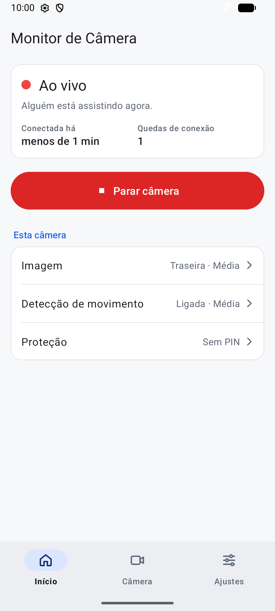
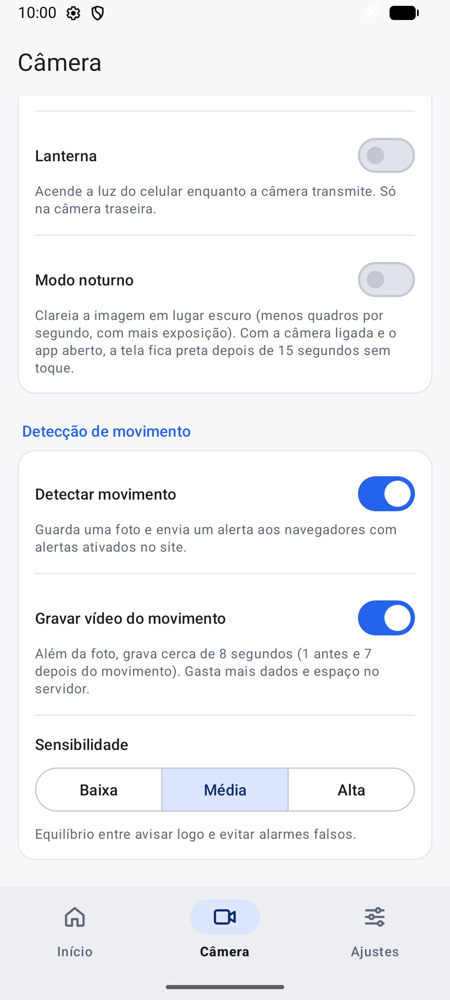
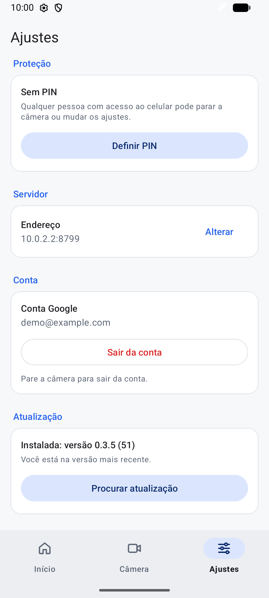
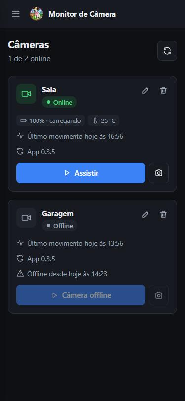
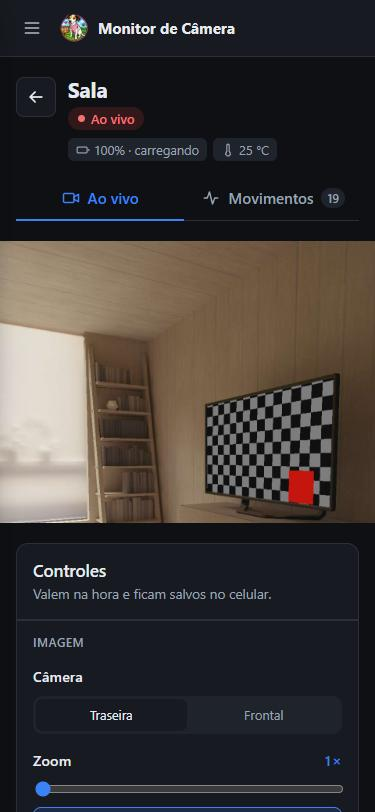
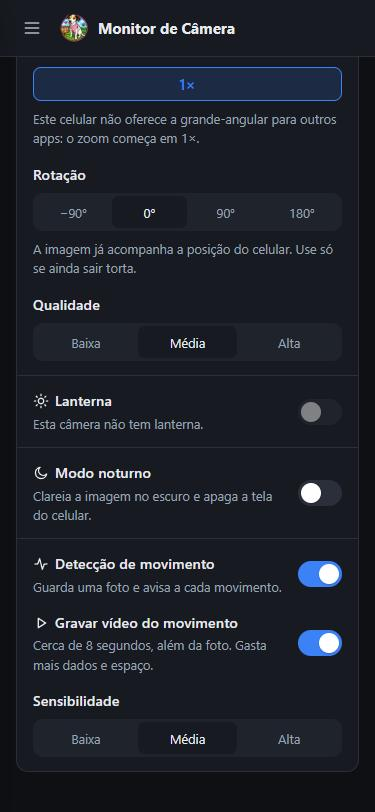
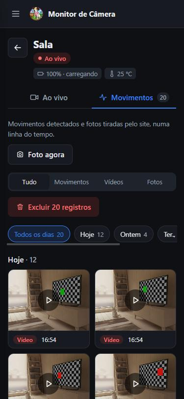
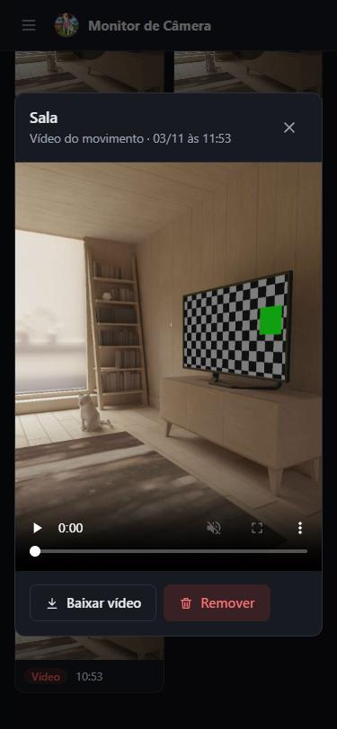
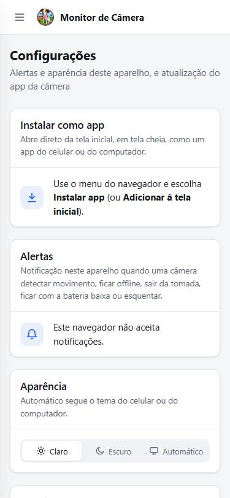
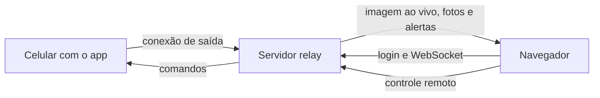

# Monitor de Câmera

Transforma um celular Android antigo em câmera de segurança. Você assiste ao vivo pelo navegador, de qualquer lugar, recebe alertas de movimento e controla a câmera à distância. Funciona por Wi-Fi, 3G ou LTE, sem abrir portas no roteador.

O projeto é auto-hospedado: o servidor roda na sua máquina e as imagens ficam com você.

## Telas

**App da câmera (Android)**

<p>
  
  
  
</p>

**Site (funciona no celular e no computador, e pode ser instalado como app)**

<p>
  
  
  
</p>
<p>
  
  
  
</p>

As capturas usam dados de demonstração: o app roda num emulador Android, com a câmera virtual dele.

## O que ele faz

- **Ao vivo:** a imagem só é transmitida quando alguém está assistindo, o que economiza dados e bateria.
- **Movimento:** detecta movimento no próprio celular, grava foto e um vídeo de cerca de 8 segundos e avisa por notificação.
- **Linha do tempo:** filtra por dia, hora e tipo, com baixar e remover em lote. Os vídeos mais antigos são apagados quando o espaço acaba.
- **Controle remoto:** muda lente, zoom, rotação, qualidade, lanterna, modo noturno e detecção pelo site.
- **Modo noturno:** clareia a imagem no escuro e apaga a tela do celular.
- **Foto agora:** tira uma foto em qualidade alta sem abrir o vídeo.
- **Alertas da câmera:** avisa se ela ficar offline, sair da tomada, estiver com bateria baixa ou esquentando.
- **Atualização pelo app:** você publica o APK no site e os celulares se atualizam, sem cabo.
- **Segurança:** login com Google, verificação em duas etapas obrigatória e PIN no app.

Os detalhes estão em [Funcionalidades](docs/funcionalidades.md).

## Como funciona



1. O app abre uma conexão de saída com o servidor, por isso não é preciso abrir portas no roteador.
2. Você entra no site com a mesma conta Google usada no app, e a câmera aparece na lista.
3. Ao tocar em **Assistir**, o servidor pede à câmera para transmitir. Quando ninguém está assistindo, a transmissão para.

## Estrutura do repositório

| Pasta | O que é |
|---|---|
| [camera-monitor](camera-monitor) | App Android em Kotlin, com CameraX. Roda no celular que fica fixado no local. |
| [relay-server](relay-server) | Servidor Node e site em Vue 3. Liga a câmera aos visualizadores. |
| [docs](docs) | Documentação detalhada e capturas de tela. |

## Começando

Você vai precisar de Docker, de Android Studio e de um cliente OAuth do Google, porque o site só tem login com Google ([como criar](docs/implantacao.md#login-com-google)).

1. Suba o servidor e o site em modo de desenvolvimento:

   ```bash
   cd relay-server
   cp .env.example .env
   docker compose -f docker-compose.dev.yml up -d --build
   ```

2. Abra `http://localhost:5173`.
3. Abra a pasta `camera-monitor` no Android Studio e instale o build debug no celular ([passo a passo](camera-monitor/README.md)).
4. No app, informe o endereço do computador (por exemplo, `192.168.1.20:8787`) e entre com a mesma conta.
5. Na aba **Início**, toque em **Iniciar câmera**.

Para publicar de verdade, com HTTPS e túnel, veja [Implantação e operação](docs/implantacao.md).

## Documentação

- [Funcionalidades](docs/funcionalidades.md): como cada recurso funciona.
- [Implantação e operação](docs/implantacao.md): variáveis de ambiente, túnel, Dokploy, backup, login com Google e 2FA.
- [API](docs/api.md): rotas HTTP e WebSocket.
- [Servidor e site](relay-server/README.md): desenvolvimento, testes e organização do código.
- [App Android](camera-monitor/README.md): compilar, testar, gerar versão e organização do código.

## Como contribuir

Contribuições são bem-vindas. Para mudanças grandes, abra uma issue antes, para combinarmos a ideia.

1. Faça um fork e crie uma branch a partir da `main`.
2. Faça a mudança, com testes quando houver regra nova.
3. Rode os testes da parte que você alterou:

   ```bash
   cd relay-server/frontend && npm install
   cd ../backend && npm install && npm test
   ```

   ```bash
   cd camera-monitor && ./gradlew testDebugUnitTest
   ```

4. Abra um pull request explicando o que mudou, por que mudou e como você testou. Mudanças em telas ficam mais fáceis de revisar com uma captura.

**Combinados do projeto:**

- Textos da interface, comentários e mensagens de commit são em português.
- Se mudar uma configuração ou um comportamento, atualize a documentação junto.
- Se o site e o app trocarem uma configuração nova, ela precisa passar pelas três partes: app, `relay-server/backend/src/services/camera-settings.js` e site.
- Nunca envie `.env`, keystore, `keystore.properties` ou qualquer segredo.

**Falhas de segurança:** não abra issue pública. Use a [denúncia privada de vulnerabilidade](https://github.com/fabricioifc/bizo-camera/security/advisories/new) do GitHub.

## Segurança

- Use sempre HTTPS em produção. Sem isso, a sessão e o vídeo trafegam sem criptografia.
- Quem entra na sua conta vê suas câmeras, por isso a verificação em duas etapas é obrigatória.
- O servidor guarda apenas hashes dos segredos e das sessões.
- Filmar pessoas tem regras legais: avise quem frequenta o local e respeite a privacidade de vizinhos e visitantes.
